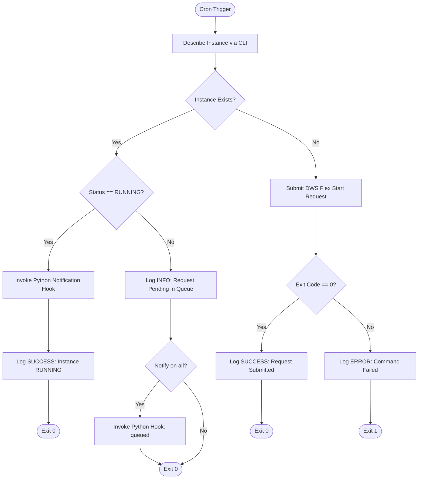

# Flex Capacity Automation (`retry-flex-cron.sh`)

An automated lifecycle management script designed to schedule and manage Dynamic Workload Scheduler (DWS) Flex Start compute instances via scheduled cron execution.

## Overview

`retry-flex-cron.sh` provides an unattended, idempotent mechanism for provisioning and monitoring DWS Flex Start instances. Executed via a cron schedule, the script verifies the current state of a targeted compute instance and submits an optimized Flex Start request if no active instance or pending request exists.

### Key Capabilities

- **Idempotency & State Awareness**: Detects existing instances prior to submission. Avoids duplicate requests if an instance is actively running or already pending in the queue.
- **Extensible Notification Hook**: When compute resources are found or confirmed in a running state, calls an extensible Python hook (`notify.py`) with all instance findings. Dispatches no external requests out of the box, allowing users to implement their own alerting logic.
- **Standardized DWS Parameters**: Submits requests with preconfigured Flex Start specifications:
  - `--provisioning-model=FLEX_START`
  - `--request-valid-for-duration=2h` (Queue validity window)
  - `--max-run-duration=7d` (Maximum runtime once provisioned)
  - `--instance-termination-action=DELETE` & `--maintenance-policy=TERMINATE` (Automatic cleanup upon workload completion)
- **Comprehensive Logging**: Appends timestamped status updates and command output to a designated log file for auditing and operational tracking.
- **Flexible CLI Interface**: Supports custom instance names, machine types, image families, projects, deployment zones, and custom notification scripts via command-line arguments.

---

## Workflow Logic



---

## Prerequisites

1. **`gcloud` CLI**: Ensure the `gcloud` command-line utility is installed and configured in the execution environment.
2. **Python 3**: Required if using the extensible notification hook (`notify.py`). Standard library only—no external packages required.
3. **Authentication & Permissions**: The executing identity (user or service account) must have permissions to view and create compute instances:
   - `roles/compute.instanceAdmin.v1` (or equivalent custom role)
4. **Execution Permissions**: Ensure the scripts have execute permissions:
   ```bash
   chmod +x retry-flex-cron.sh notify.py
   ```

---

## Configuration & CLI Options

The script accepts the following command-line flags:

| Flag | Long Option | Description | Default | Required |
| :--- | :--- | :--- | :--- | :--- |
| `-p` | `--project` | Target Project ID | *None* | **Yes** |
| `-n` | `--name` | Target instance name | `tpu-v7x-flex` | No |
| `-z` | `--zone` | Target deployment zone | `us-central1-c` | No |
| `-m` | `--machine-type` | Compute / accelerator machine type | `tpu7x-standard-4t` | No |
| `-f` | `--image-family` | OS image family | `ubuntu-accel-2404-amd64-tpu-tpu7x` | No |
| `-i` | `--image-project` | Image project name | `ubuntu-os-accelerator-images` | No |
| `-l` | `--log-file` | Target log file path | `/tmp/retry-flex-cron.log` | No |
| `-s` | `--notify-script` | Path to notification Python script | `notify.py` (if present) | No |
| — | `--notify-on` | Trigger condition: `running` or `all` | `running` | No |
| — | `--no-notify` | Disable notification hook completely | — | No |
| `-h` | `--help` | Display usage and exit | — | — |

---

## Extensible Notification Hook (`notify.py`)

When resources are allocated and the instance is confirmed `RUNNING`, `retry-flex-cron.sh` automatically calls `notify.py` (or a custom script specified via `-s`) and passes the finding details as CLI arguments:

```bash
python3 notify.py \
  --event "resource_found" \
  --status "RUNNING" \
  --name "accelerator-workload-01" \
  --project "example-project-id" \
  --zone "us-central1-c" \
  --machine-type "tpu7x-standard-4t" \
  --ip "10.0.0.1" \
  --log-file "/tmp/retry-flex-cron.log" \
  --timestamp "2026-09-05T20:00:00Z"
```

### Self-Implemented Delivery

By design, `notify.py` does **not** make any external network requests out of the box. It formats and logs the findings locally. You can customize the `send_custom_notification(findings)` function in `notify.py` to deliver alerts however your workflow requires:

```python
def send_custom_notification(findings: dict) -> None:
    """
    Implement your notification logic here.
    findings dictionary keys:
      - 'event': str ('resource_found', 'resource_queued')
      - 'status': str ('RUNNING', etc.)
      - 'instance_name': str
      - 'project': str
      - 'zone': str
      - 'machine_type': str
      - 'ip_address': str
      - 'timestamp': str
      - 'log_file': str
    """
    # Example: Slack / Discord webhook
    # import urllib.request
    # webhook_url = os.environ.get("NOTIFICATION_WEBHOOK_URL")
    # if webhook_url:
    #     payload = json.dumps({"text": f"Instance {findings['instance_name']} is RUNNING at IP {findings['ip_address']}."}).encode("utf-8")
    #     req = urllib.request.Request(webhook_url, data=payload, headers={"Content-Type": "application/json"})
    #     urllib.request.urlopen(req)

    # Example: Email / SMTP notification
    # import smtplib
    # ...
```

### Testing the Notification Hook

You can test `notify.py` independently without running the full cron script:

```bash
./notify.py \
  --event "resource_found" \
  --status "RUNNING" \
  --name "test-workload" \
  --project "example-project-id" \
  --zone "us-central1-c" \
  --ip "198.51.100.10"
```

---

## Usage Examples

### Manual Execution

Run the script directly to validate parameters and verify configuration:

```bash
./retry-flex-cron.sh \
  --project "example-project-id" \
  --name "accelerator-workload-01" \
  --zone "us-central1-c" \
  --machine-type "tpu7x-standard-4t"
```

### Scheduled Cron Execution

To run the script automatically every 2 hours (aligning with the default 2-hour queue request validity window):

1. Open the user crontab:
   ```bash
   crontab -e
   ```

2. Add the scheduled entry:
   ```cron
   # Execute Flex Start automated retry every 2 hours
   0 */2 * * * /path/to/retry-flex-cron.sh --project "example-project-id" --name "accelerator-workload-01" --zone "us-central1-c" >> /tmp/retry-flex-cron-wrapper.log 2>&1
   ```

> **Note on Environment Paths**: Scheduled cron tasks run in a restricted environment. Ensure the directory containing `gcloud` and `python3` is included in the `PATH` definition within your crontab, or prepend the path directly:
> ```cron
> PATH=/usr/local/bin:/usr/bin:/bin:/path/to/cloud-sdk/bin
> ```

---

## Logging & Observability

All operational events, hook invocations, and output streams are appended with timestamps to the configured log destination (default: `/tmp/retry-flex-cron.log`).

### Monitoring Logs

View recent activity and real-time execution logs:

```bash
tail -f /tmp/retry-flex-cron.log
```

### Sample Log Output

```text
[2026-09-05 20:00:00] --- Cron run started for accelerator-workload-01 in us-central1-c ---
[2026-09-05 20:00:01] INFO: No instance found. Submitting DWS Flex request (valid for 2 hours)...
[2026-09-05 20:00:06] SUCCESS: Flex request submitted successfully.
[2026-09-05 22:00:00] --- Cron run started for accelerator-workload-01 in us-central1-c ---
[2026-09-05 22:00:01] SUCCESS: Instance 'accelerator-workload-01' is RUNNING! No action needed.
[2026-09-05 22:00:02] INFO: Triggering notification hook (./notify.py) for event 'resource_found' with status 'RUNNING'...
[2026-09-05 22:00:02] [Notification Hook] Event: resource_found | Instance: accelerator-workload-01 | Status: RUNNING | Zone: us-central1-c | IP: 10.0.0.1 | Machine Type: tpu7x-standard-4t
[2026-09-05 22:00:02] INFO: Notification hook executed successfully.
```

---

## Technical Specifications

- **Provisioning Model**: `FLEX_START` (Dynamic Workload Scheduler)
- **Request Validity Window**: 2 hours (`--request-valid-for-duration=2h`)
- **Maximum Execution Duration**: 7 days (`--max-run-duration=7d`)
- **Lifecycle Termination Actions**: Delete on shutdown (`--instance-termination-action=DELETE`, `--maintenance-policy=TERMINATE`)
- **Reservation Policy**: None (`--reservation-affinity=none`)
- **Notification Integration**: Optional Python hook (`notify.py`) executed on discovery with zero external network dependencies out of the box
