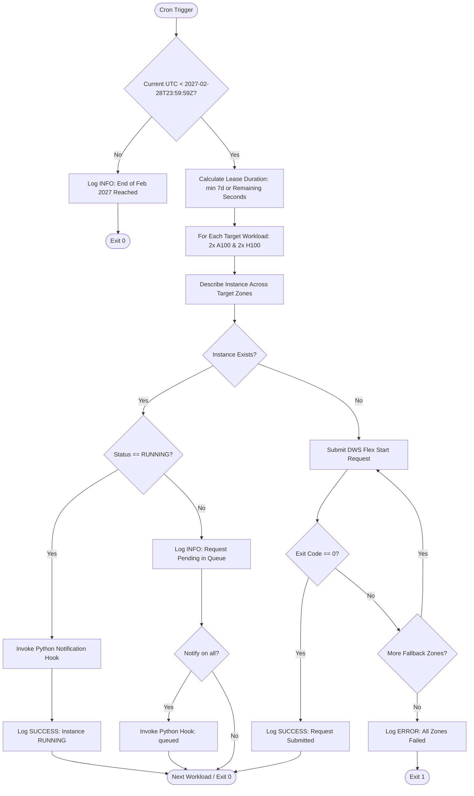

# Flex Capacity Automation (`retry-flex-cron.sh`)

An automated lifecycle management script designed to schedule and maintain **2x NVIDIA A100** (`a2-highgpu-2g`) and **2x NVIDIA H100** (`a3-highgpu-2g`) Dynamic Workload Scheduler (DWS) Flex Start GPU instances via scheduled cron execution through the **end of February 2027 (`2027-02-28T23:59:59Z`)**.

## Overview

`retry-flex-cron.sh` provides an unattended, idempotent mechanism for provisioning and monitoring DWS Flex Start GPU instances across consecutive 7-day DWS leases until a configured campaign end date (`2027-02-28T23:59:59Z` by default). Executed via a cron schedule, the script verifies the current state of both the **2x A100** and **2x H100** compute instances, submits optimized Flex Start requests if no active instance or pending request exists, dynamically caps the final lease duration so instances terminate cleanly at the end of February 2027, and stops submitting requests once the campaign window expires.

### Key Capabilities

- **Dual-GPU Fleet Support (2x A100 + 2x H100)**:
  - **2x NVIDIA A100 GPUs**: Provisions `a100-2x-flex` using `a2-highgpu-2g` (24 vCPUs, 170 GB RAM, 2x NVIDIA A100 40GB GPUs; configurable to `a2-ultragpu-2g` for 2x A100 80GB).
  - **2x NVIDIA H100 GPUs**: Provisions `h100-2x-flex` using `a3-highgpu-2g` (52 vCPUs, 468 GB RAM, 2x NVIDIA H100 80GB GPUs).
- **Campaign Expiration & Dynamic Lease Capping (`2027-02-28T23:59:59Z`)**:
  - Automatically enforces the campaign end date (`2027-02-28T23:59:59Z`, configurable via `--end-date` / `--until`).
  - Because DWS Flex Start enforces a maximum 7-day runtime per lease (`--max-run-duration=7d`), the cron schedule seamlessly re-requests capacity whenever a 7-day lease expires prior to February 28, 2027.
  - During the final 7 days of February 2027, the script dynamically reduces `--max-run-duration` to the exact number of seconds remaining until `2027-02-28T23:59:59Z` and ceases all new submissions once March 2027 begins.
- **Multi-Zone Fallback Support**: Accepts either a single zone (e.g., `us-central1-c`) or a comma-separated list of fallback zones (e.g., `us-central1-c,us-central1-a,us-central1-b`).
- **Idempotency & State Awareness**: Detects existing instances across configured zones prior to submission. Avoids duplicate requests if an instance is actively `RUNNING` or already pending in the queue.
- **Extensible Notification Hook**: When compute resources are found or confirmed in a running state, calls `notify.py` with GPU model, GPU count, machine type, zone, IP, and campaign expiration details.

---

## Workflow Logic



---

## Prerequisites

1. **`gcloud` CLI**: Ensure the `gcloud` command-line utility is installed and configured in the execution environment.
2. **Python 3**: Required for the extensible notification hook (`notify.py`) and cross-platform ISO-8601 date fallback parsing. Standard library only—no external packages required.
3. **Authentication & Permissions**: The executing identity (user or service account) must have permissions to view and create compute instances:
   - `roles/compute.instanceAdmin.v1` (or equivalent custom role)
4. **Execution Permissions**: Ensure the scripts have execute permissions:
   ```bash
   chmod +x retry-flex-cron.sh notify.py
   ```

---

## Configuration & CLI Options

The script accepts the following command-line flags:

| Flag | Long Option | Description | Default | Required |
| :--- | :--- | :--- | :--- | :--- |
| `-p` | `--project` | Target GCP Project ID | *None* | **Yes** |
| `-g` | `--gpu-profile` | GPU profile: `both` (2x A100 + 2x H100), `a100`, `h100`, or `custom` | `both` | No |
| `-z` | `--zone` | Target zone or comma-separated fallback zones | `us-central1-c,us-central1-b,us-central1-a,us-central1-f` | No |
| `-e` | `--end-date`, `--until` | Campaign expiration timestamp (ISO-8601 UTC) | `2027-02-28T23:59:59Z` | No |
| — | `--a100-name` | Instance name for the 2x A100 workload | `a100-2x-flex` | No |
| — | `--a100-machine-type` | Machine type for 2x A100 GPUs (`a2-highgpu-2g` or `a2-ultragpu-2g`) | `a2-highgpu-2g` | No |
| — | `--h100-name` | Instance name for the 2x H100 workload | `h100-2x-flex` | No |
| — | `--h100-machine-type` | Machine type for 2x H100 GPUs (`a3-highgpu-2g`) | `a3-highgpu-2g` | No |
| `-n` | `--name` | Custom instance name (for single-workload override) | — | No |
| `-m` | `--machine-type` | Custom machine type (for single-workload override) | — | No |
| `-f` | `--image-family` | OS image family | `ubuntu-accelerator-2404-amd64-with-nvidia-580` | No |
| `-i` | `--image-project` | Image project name | `ubuntu-os-accelerator-images` | No |
| `-l` | `--log-file` | Target log file path | `/tmp/retry-flex-cron.log` | No |
| `-s` | `--notify-script` | Path to notification Python script | `notify.py` (if present) | No |
| — | `--notify-on` | Trigger condition: `running` or `all` | `running` | No |
| — | `--no-notify` | Disable notification hook completely | — | No |
| `-h` | `--help` | Display usage and exit | — | — |

---

## Extensible Notification Hook (`notify.py`)

When resources are allocated and an instance is confirmed `RUNNING`, `retry-flex-cron.sh` automatically calls `notify.py` (or a custom script specified via `-s`) and passes the finding details as CLI arguments:

```bash
python3 notify.py \
  --event "resource_found" \
  --status "RUNNING" \
  --name "h100-2x-flex" \
  --project "example-project-id" \
  --zone "us-central1-c" \
  --machine-type "a3-highgpu-2g" \
  --gpu-type "NVIDIA_H100" \
  --gpu-count 2 \
  --end-date "2027-02-28T23:59:59Z" \
  --ip "10.0.0.1" \
  --log-file "/tmp/retry-flex-cron.log" \
  --timestamp "2026-10-23T22:00:00Z"
```

### Self-Implemented Delivery

By design, `notify.py` does **not** make any external network requests out of the box. It formats and logs the findings locally. You can customize the `send_custom_notification(findings)` function in `notify.py` to deliver alerts however your workflow requires:

```python
def send_custom_notification(findings: dict) -> None:
    """
    Implement your notification logic here.
    findings dictionary keys:
      - 'event': str ('resource_found', 'resource_queued')
      - 'status': str ('RUNNING', etc.)
      - 'instance_name': str
      - 'project': str
      - 'zone': str
      - 'machine_type': str ('a2-highgpu-2g', 'a3-highgpu-2g')
      - 'gpu_type': str ('NVIDIA_A100', 'NVIDIA_H100')
      - 'gpu_count': int (2)
      - 'end_date': str ('2027-02-28T23:59:59Z')
      - 'ip_address': str
      - 'timestamp': str
      - 'log_file': str
    """
```

---

## Usage Examples

### 1. Provision Both 2x A100 and 2x H100 GPUs Until End of February 2027 (Default)

Run the script directly to submit or verify both `a100-2x-flex` (`a2-highgpu-2g`) and `h100-2x-flex` (`a3-highgpu-2g`) in `us-central1`:

```bash
./retry-flex-cron.sh \
  --project "example-project-id" \
  --zone "us-central1-c,us-central1-a,us-central1-b" \
  --end-date "2027-02-28T23:59:59Z"
```

### 2. Provision Only 2x A100 or Only 2x H100 GPUs

```bash
# 2x A100 GPUs only
./retry-flex-cron.sh --project "example-project-id" --gpu-profile a100 --zone "us-central1-c"

# 2x H100 GPUs only
./retry-flex-cron.sh --project "example-project-id" --gpu-profile h100 --zone "us-central1-c"
```

### 3. Scheduled Cron Execution (Through End of February 2027)

To run the script automatically every 2 hours (aligning with the default 2-hour queue request validity window and automatically renewing 7-day Flex Start leases until `2027-02-28T23:59:59Z`):

1. Open the user crontab:
   ```bash
   crontab -e
   ```

2. Add the scheduled entry:
   ```cron
   # Maintain 2x A100 (a2-highgpu-2g) and 2x H100 (a3-highgpu-2g) GPUs via DWS Flex Start until end of Feb 2027
   0 */2 * * * /path/to/retry-flex-cron.sh --project "example-project-id" --zone "us-central1-c,us-central1-a,us-central1-b" --end-date "2027-02-28T23:59:59Z" >> /tmp/retry-flex-cron-wrapper.log 2>&1
   ```

---

## Technical Specifications

- **Target Hardware**:
  - **2x NVIDIA A100 GPUs**: `a2-highgpu-2g` (24 vCPUs, 170 GB RAM) or `a2-ultragpu-2g` (2x A100 80GB)
  - **2x NVIDIA H100 GPUs**: `a3-highgpu-2g` (52 vCPUs, 468 GB RAM, 2x H100 80GB)
- **Provisioning Model**: `FLEX_START` (Dynamic Workload Scheduler)
- **Campaign Window**: Active until `2027-02-28T23:59:59Z` (End of February 2027)
- **Request Validity Window**: 2 hours (`--request-valid-for-duration=2h`)
- **Maximum Execution Duration per Lease**: 7 days (`--max-run-duration=7d`, dynamically capped to remaining seconds when `< 7d` remain before `2027-02-28T23:59:59Z`)
- **Lifecycle Termination Actions**: Delete on shutdown (`--instance-termination-action=DELETE`, `--maintenance-policy=TERMINATE`)
- **Reservation Policy**: None (`--reservation-affinity=none`)
